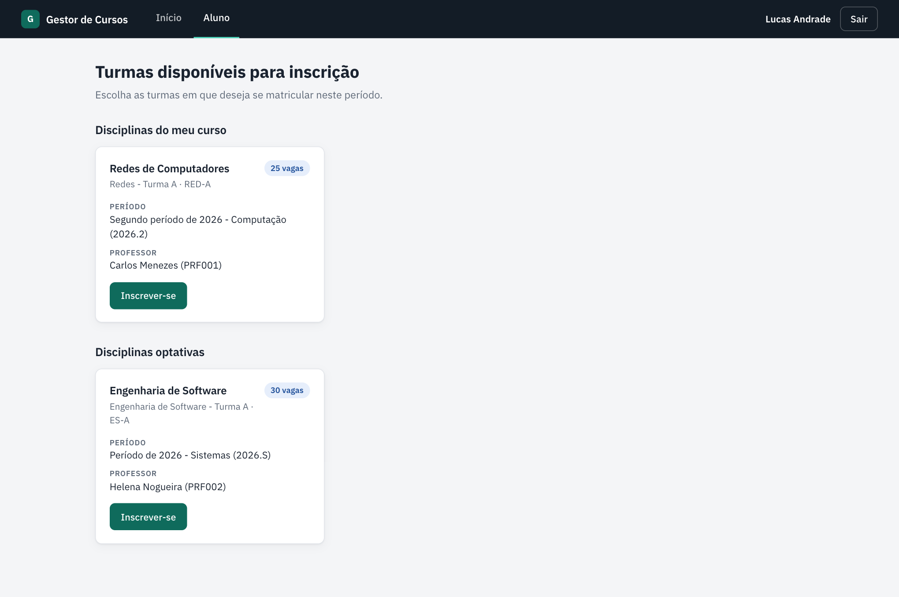
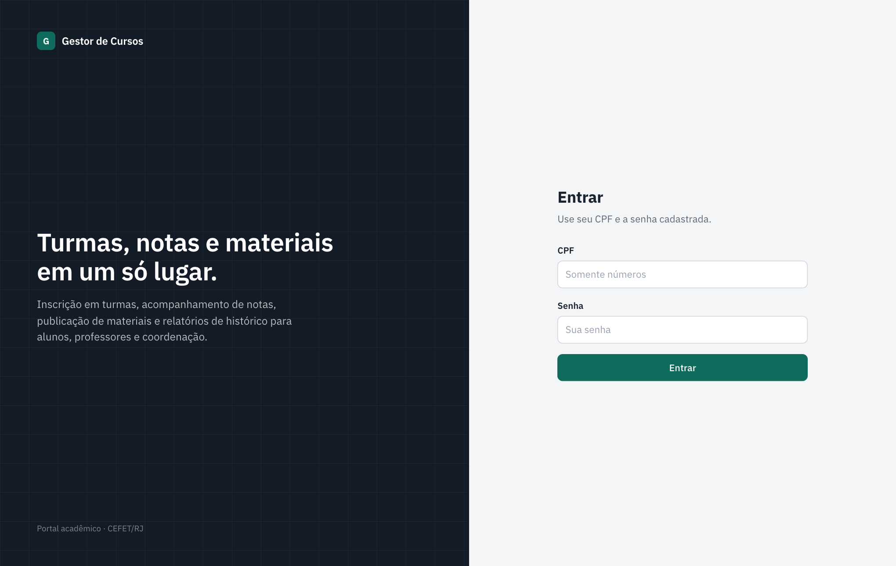
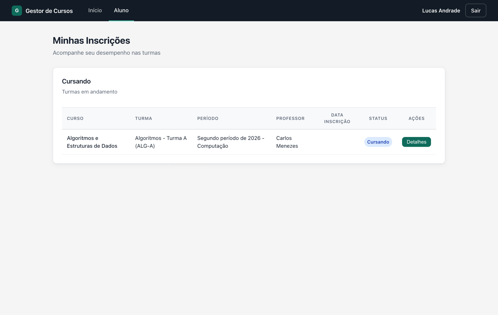
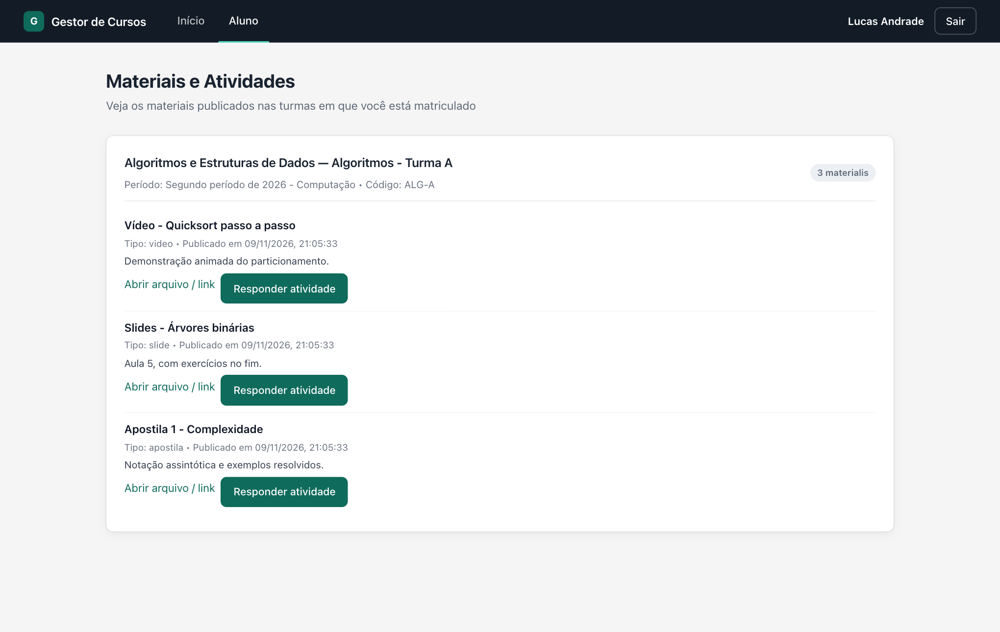
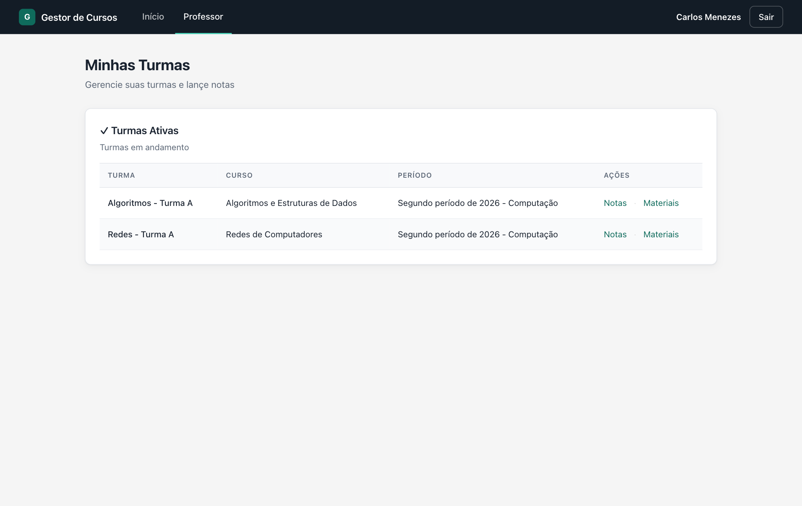
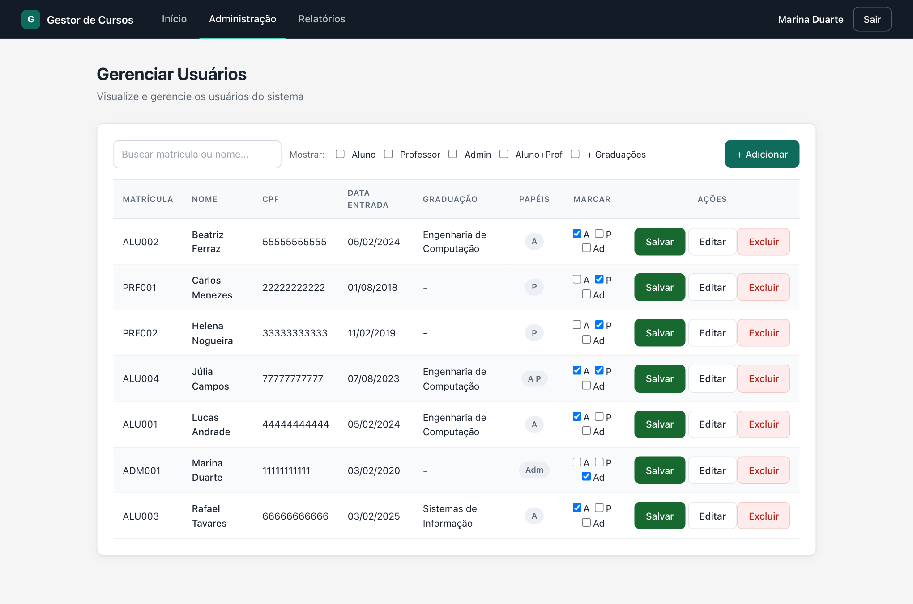
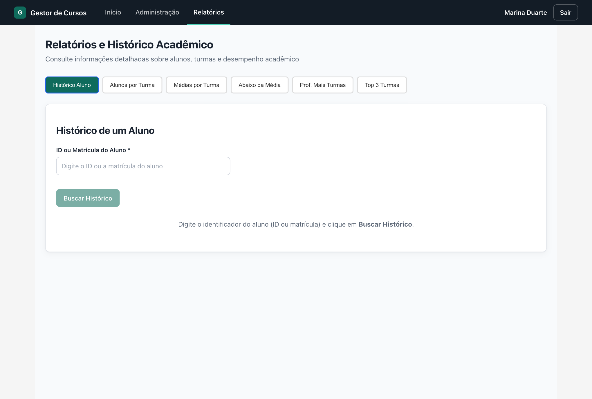

# Portal Acadêmico

Sistema web para gestão de cursos, turmas, inscrições, notas e materiais de aula. Alunos se inscrevem em turmas e acompanham o desempenho, professores lançam notas e publicam materiais, e a coordenação administra usuários, cursos, períodos e relatórios.

O projeto foi feito para a disciplina de Banco de Dados (CEFET/RJ). O foco está no banco: as regras de negócio vivem em **triggers e procedures MySQL**, e a aplicação (API em Node.js e interface em React) consome essas regras sem duplicá-las.



## Funcionalidades

**Aluno**
- Lista as turmas abertas, separando as do seu curso das optativas
- Inscrição em turmas, com fila de espera quando as vagas regulares acabam
- Acompanhamento de notas (P1, P2, prova final), média e situação
- Materiais de aula e envio de respostas para atividades

**Professor**
- Turmas ativas e alunos matriculados
- Lançamento de P1, P2 e prova final
- Aprovação ou rejeição de inscrições pendentes
- Publicação de materiais e atividades

**Administração**
- Cadastro de usuários com perfis combináveis (aluno, professor, administrador)
- Cursos, períodos letivos e turmas
- Relatórios: histórico de um aluno, alunos por turma, médias por turma, alunos abaixo da média, professores com mais turmas e as turmas mais concorridas

## Telas

| Login | Minhas inscrições |
|---|---|
|  |  |

| Materiais e atividades | Turmas do professor |
|---|---|
|  |  |

| Administração de usuários | Relatórios |
|---|---|
|  |  |

## Tecnologias

| Camada | Tecnologias |
|--------|-------------|
| Banco de dados | MySQL 8+, com triggers, procedures e índices |
| Back-end | Node.js, Express 5, mysql2 (pool de conexões), CORS |
| Front-end | React 18, React Router 7, Vite 5 |

## Arquitetura

```
Front (React)  ──HTTP/JSON──▶  Back (Express)  ──SQL──▶  MySQL
                                   │
                  routes ─▶ controller ─▶ service
```

O back-end segue três camadas por recurso (aluno, curso, turma, inscrição e assim por diante):

- `routes/`: define os caminhos HTTP e liga cada um a um controller.
- `controller/`: valida a entrada, devolve o código HTTP certo e trata erros.
- `services/`: concentra o SQL. É a única camada que fala com o banco.

Quanto ao banco, as decisões importantes ficam nele: o cálculo de média, a validação de inscrição e o fechamento da turma acontecem em triggers. Assim, qualquer cliente que escreva no banco respeita as mesmas regras. Os detalhes estão em [`docs/REGRAS_DE_NEGOCIO.md`](docs/REGRAS_DE_NEGOCIO.md).

## Como executar

Pré-requisitos: Node.js 18 ou superior e MySQL 8 ou superior.

### 1. Banco de dados

```bash
mysql -u root -p < database/schema.sql   # tabelas e triggers
mysql -u root -p < database/seed.sql     # dados de demonstração (opcional)
```

O `seed.sql` cria sete usuários fictícios, cuja senha é `123456`:

| CPF | Perfil | Nome |
|-----|--------|------|
| `11111111111` | Administrador | Marina Duarte |
| `22222222222` | Professor | Carlos Menezes |
| `33333333333` | Professor | Helena Nogueira |
| `44444444444` | Aluno | Lucas Andrade |
| `55555555555` | Aluno | Beatriz Ferraz |
| `66666666666` | Aluno | Rafael Tavares |
| `77777777777` | Aluno e professor | Júlia Campos |

> O arquivo `db.sql` na raiz é o script original da entrega da disciplina. Ele cria `usuario` antes de `graduacao`, o que faz o MySQL recusar o script. A versão corrigida e pronta para uso é `database/schema.sql`.

### 2. Back-end

```bash
cd Back
npm install
```

Edite `src/config/database.js` com o usuário e a senha do seu MySQL local e inicie:

```bash
npm run dev     # http://localhost:3001
```

### 3. Front-end

```bash
cd Front
npm install
npm run dev     # http://localhost:5173
```

Abra `http://localhost:5173` e entre com um dos CPFs acima.

## Estrutura do repositório

```
.
├── Back/
│   └── src/
│       ├── app.js              # servidor Express e montagem das rotas
│       ├── config/database.js  # pool de conexões MySQL
│       ├── routes/             # caminhos HTTP
│       ├── controller/         # entrada, saída e erros
│       └── services/           # consultas SQL
├── Front/
│   └── src/
│       ├── App.jsx             # layout, navegação e rotas por perfil
│       ├── context/            # autenticação
│       ├── pages/              # uma página por tela
│       └── index.css           # sistema de design
├── database/
│   ├── schema.sql              # tabelas, chaves e triggers
│   └── seed.sql                # dados de demonstração
├── docs/
│   ├── API.md                  # referência dos endpoints
│   ├── REGRAS_DE_NEGOCIO.md    # regras implementadas no banco
│   └── screenshots/
└── db.sql                      # script original da disciplina
```

## Perfis de usuário

O campo `usuario.tipo` é uma máscara de bits, então a mesma pessoa pode ter mais de um papel:

| Bit | Valor | Papel |
|-----|-------|-------|
| 0 | 1 | Aluno |
| 1 | 2 | Professor |
| 2 | 4 | Administrador |

Um usuário com `tipo = 3` é aluno e professor ao mesmo tempo. O front-end usa essa máscara para decidir quais rotas e itens de menu mostrar.

## Documentação

- [Referência da API](docs/API.md)
- [Regras de negócio no banco](docs/REGRAS_DE_NEGOCIO.md)
